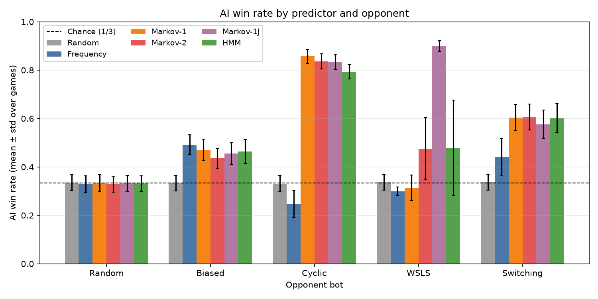
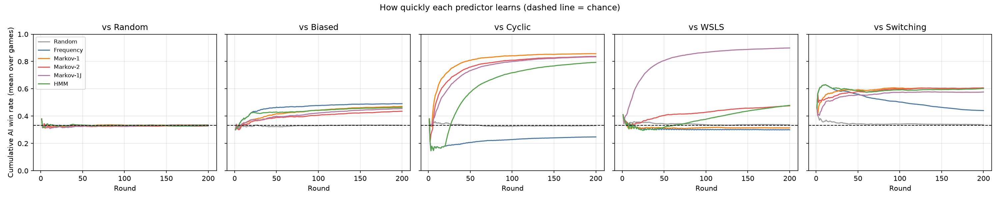
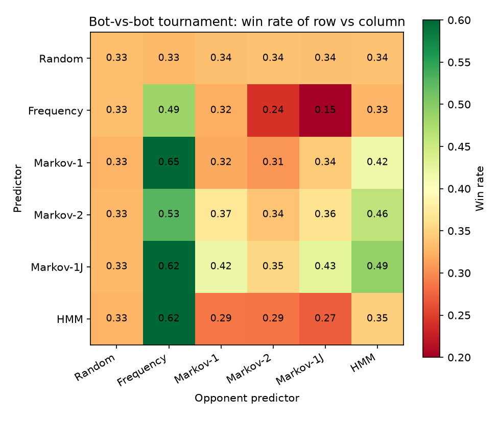
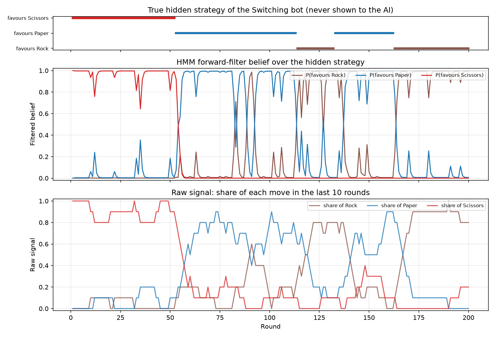
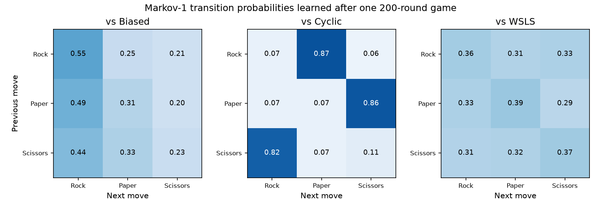
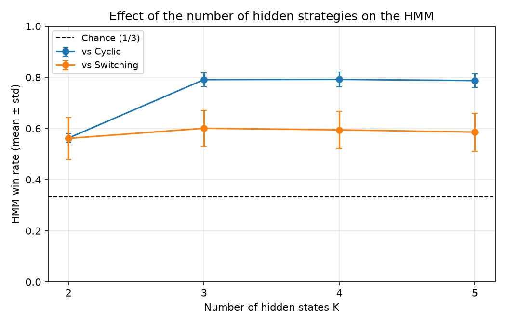

# AL-2002 Project Report: Rock-Paper-Scissors Mind Reader

20 November 2026

| Item | Details |
|---|---|
| Course | AL-2002 — Artificial Intelligence (Laboratory), Fall 2026, FAST-NUCES Karachi |
| Project | Rock-Paper-Scissors Mind Reader (Idea 08) |
| Section | A |
| Group leader | Muneeb Mustafa (24K-3102) |
| Member 2 | Huzaifa Shahid (24K-3069) |
| Repository | https://github.com/huzaifashahid9/AI-Project-Python |
| Reproduce all results | `python src/experiment.py --seed 42` |

## 1. Introduction

People are poor random-number generators. In a repeated game of Rock-Paper-Scissors, a human's next move often depends on their previous moves: they repeat a move that just won, avoid a move that just lost, or fall into a cycle. An agent that learns these habits can predict the next move and play the move that beats it, winning more often than the one-third that chance allows.

We built such an agent. It observes only the opponent's revealed moves and never the strategy behind them. It models the opponent with interchangeable predictors: a random baseline, a frequency model, Markov chains of order 1 and 2, an order-1 Markov chain whose context is the whole previous round, and a Hidden Markov Model in which the opponent's hidden strategy is the state.

The system has three parts: a Streamlit game where a person can play the agent; five seeded scripted bots that generate reproducible data; and an experiment script that runs 100 games of 200 rounds for every predictor-bot pairing, plus a round-robin tournament between the predictors. All the numbers in this report come from that script with seed 42.

## 2. Problem Formulation

### 2.1 PEAS

| PEAS | Description |
|---|---|
| Performance measure | AI win rate over a 200-round match (wins ÷ rounds); anything above 1/3 beats chance. Tie and loss rates are also reported. |
| Environment | A repeated two-player game of Rock-Paper-Scissors against a human, a scripted bot with a hidden strategy, or another AI agent. |
| Actuators | Choosing Rock, Paper or Scissors each round. |
| Sensors | The opponent's revealed move after each round (and therefore the result and running score). |

### 2.2 Environment classification

| Property | Value | Reason |
|---|---|---|
| Observability | Partially observable | The opponent's strategy (the HMM's hidden state) is never observed, only its moves. |
| Determinism | Stochastic | Bots and humans choose moves randomly within their strategy (for example, 10% noise). |
| Episodic / sequential | Sequential | Earlier rounds are the evidence for later predictions. |
| Static / dynamic | Static | Nothing changes while the agent is deciding. |
| Discrete / continuous | Discrete | Three actions, a finite number of rounds. |
| Agents | Multi-agent (competitive) | A zero-sum game against an opponent who may also adapt. |

### 2.3 Agent type

The agent is a **learning, model-based agent**:

- **Model:** the agent keeps an internal model of the opponent (count tables, or HMM parameters and a belief). Its decision depends on that model, not only on the current percept.
- **Learning:** it updates the model after every round.
- **Decision rule:** it is utility-based. It chooses the action with the highest expected utility under its forecast (Section 4.1).

### 2.4 Search formulation

| Element | Representation |
|---|---|
| State | The opponent's last *k* moves (*k* = 1 or 2), encoded 0 = Rock, 1 = Paper, 2 = Scissors. For Markov-1J, the last round as the pair (opponent move, AI move). For the HMM, the full move sequence and a belief over hidden strategies. |
| Actions | Rock, Paper, Scissors |
| Initial state | Empty history, score 0–0 |
| Transition | Both players commit to a move; the moves are revealed; both players observe them. |
| Terminal test | 200 rounds played (`Game.is_over`) |
| Utility | +1 win, 0 tie, −1 loss per round (`rps.PAYOFF`) |

## 3. System Design

### 3.1 Module layout

| Module | Contents | Author |
|---|---|---|
| `src/rps.py` | Move encoding, `PAYOFF` matrix, `outcome`, `counter_move`, input parsing and validation | Muneeb |
| `src/game.py` | `Player` (abstract), `HumanPlayer`, `Game` (environment), `RoundRecord`, `MatchResult` | Muneeb |
| `src/predictors.py` | `Predictor` (abstract), `RandomPredictor`, `FrequencyPredictor`, `MarkovPredictor` | Muneeb |
| `src/agent.py` | `AIAgent`, `make_predictor`, `make_agent` | Muneeb |
| `src/app.py` | Streamlit app: Play vs AI, Bot vs Bot, Tournament | Muneeb |
| `src/hmm_predictor.py` | `HMMPredictor`, `forward_step`, `forward_filter` | Huzaifa |
| `src/bots.py` | `Opponent` (abstract) and five bots, `make_bot` | Huzaifa |
| `src/tournament.py` | Seeded match runners, round-robin, HMM belief trace, K ablation | Huzaifa |
| `src/experiment.py` | Command-line entry point that writes all tables and figures | Huzaifa |
| `src/plots.py` | The six labelled charts | Huzaifa |
| `tests/` | 48 pytest tests | Both |

### 3.2 Object-oriented design

There are two class hierarchies:

```
Player (ABC)                         Predictor (ABC)
├── HumanPlayer                      ├── RandomPredictor
├── AIAgent ──has-a──▶ Predictor     ├── FrequencyPredictor
└── Opponent (ABC)                   ├── MarkovPredictor   (order 1/2, context opponent/joint)
    ├── RandomBot                    └── HMMPredictor
    ├── BiasedBot
    ├── CyclicBot                    Game ──uses──▶ two Players ──produces──▶ MatchResult
    ├── WinStayLoseShiftBot
    └── SwitchingBot
```

How the design meets the OOP requirements:

- **Inheritance and overriding.**
  - `Player.next_move` is abstract and is overridden by `HumanPlayer`, `AIAgent` and `Opponent`.
  - `Opponent.next_move` adds noise, then calls the abstract `strategy_move`, which each bot overrides. `SwitchingBot` overrides `next_move` again to add strategy switching.
  - `Predictor.predict_proba` is abstract and is overridden by every predictor.
  - `MarkovPredictor.update` overrides `Predictor.update` to validate its input.
  - `reset` is extended with `super().reset()` throughout.
- **Encapsulation.**
  - Each player owns a private seeded generator (`Player._rng`).
  - The HMM keeps its parameters and belief internal and exposes them read-only through `is_fitted`, `filtered_beliefs()` and `describe()`.
  - `Game` is the only place where moves are exchanged.
- **Composition.** `AIAgent` wraps any `Predictor`. The same agent code can therefore use any model, and the app and experiments select a model by name through `make_agent`.
- **Reproducibility.** Every random choice uses a `random.Random(seed)` owned by the object. hmmlearn receives `random_state` derived from the same seed. `experiment.py` also seeds the global `random` and `numpy` generators.

### 3.3 Seeding scheme

In game *i* of every pairing, the bot uses seed `42 + i` and the AI uses `42 + i + 10000` (in the tournament, the second agent uses `42 + i + 20000`). Every predictor therefore faces exactly the same opponent move streams, so differences in win rate come from the predictors and not from luck.

Games are independent, so `experiment.py` runs them in a process pool. We checked that the output CSVs are byte-identical with `--jobs 1` and with `--jobs 10`.

## 4. Implementation of the AI Techniques (Lab 09: probabilistic reasoning)

### 4.1 Decision rule shared by all predictors

Each round, `AIAgent.next_move` performs three steps:

1. It asks its predictor for a forecast *p* = P(opponent's next move).
2. It computes the expected utility of each action, **EU(a) = Σ_b p(b) · PAYOFF[a, b]**, with PAYOFF = +1 for a win, 0 for a tie and −1 for a loss.
3. It plays the action with the highest expected utility, breaking ties with its seeded generator.

This is better than "counter the single most likely move" when two moves are almost equally likely. For example, if *p* = (0.45, 0.45, 0.10), Paper has EU = 0.45 − 0.10 = 0.35, while Scissors has EU = 0. A uniform forecast makes every EU equal, so the agent plays randomly. That is exactly the baseline.

After the round, `AIAgent.observe` passes both moves to `Predictor.update`.

### 4.2 Random predictor (baseline)

`RandomPredictor.predict_proba` always returns (1/3, 1/3, 1/3). Against any opponent its expected win rate is exactly 1/3.

### 4.3 Frequency predictor

`FrequencyPredictor` estimates P(m) = (count(m) + α) / (n + 3α) with Laplace smoothing α = 1.

The smoothing prevents zero probabilities early in a match and makes the first forecast uniform. The predictor ignores order, so it can exploit a biased player but not a cycling one.

### 4.4 Markov chain predictors, order 1 and 2

`MarkovPredictor` treats the opponent's last *k* moves as the state.

**Transition model.** `counts[ctx][m]` stores how often move *m* followed context *ctx*. The transition probability is the smoothed relative count:

> P(m | ctx) = (counts[ctx][m] + α) / (Σ counts[ctx] + 3α)

Order 1 has 3 contexts and order 2 has 9 contexts, giving count tables of shape 3×3 and 3×3×3. `_learn` increments one cell per round. Until *k* moves have been seen, `predict_proba` falls back to the frequency estimate.

**Decay.** An optional parameter `decay` ∈ (0, 1] multiplies all counts before each update, so old evidence fades. The default is 1.0. A unit test shows that decay 0.8 follows a player who changes habit, while decay 1.0 does not.

**Bias-variance trade-off.** Order 2 can represent longer patterns, but it spreads the same 200 observations over three times as many contexts. Section 5 shows this cost.

`transition_table()` returns the learned matrix shown in Figure 5 and in the app.

### 4.5 Markov-1J: a joint-context extension

Our first full run showed that every predictor in the proposal fell to about 30% against the win-stay/lose-shift bot. That bot's next move depends on the *result* of the last round, and so on the AI's own move, which a model of the opponent's moves alone cannot see. The learned Markov-1 table against WSLS is almost uniform (Figure 5, right).

We therefore added `context="joint"`. Each context symbol is the whole previous round, encoded as 3 × opponent_move + ai_move (9 symbols). Otherwise the predictor is the same Markov chain.

This is an addition to the proposal, and it is reported as a separate predictor so that the proposal's five are unchanged.

### 4.6 Hidden Markov Model predictor

`HMMPredictor` (in `src/hmm_predictor.py`) models the player as switching between *K* hidden strategies:

| Component | Meaning | Variable |
|---|---|---|
| Hidden state z_t | The strategy in use at round t | — |
| Observation x_t | The move played (R/P/S) | `history` |
| Transition model A[i, j] | P(z_{t+1} = j \| z_t = i): how likely the player is to switch strategy | `transmat` |
| Emission (sensor) model B[i, m] | P(x_t = m \| z_t = i): how likely each move is under a strategy | `emission` |
| Initial distribution π | P(z_1) | `startprob` |

**Learning (hmmlearn).** Every `refit_every` = 10 rounds, once at least `min_history` = 20 moves exist, `_fit` runs Baum-Welch (expectation-maximisation) using `hmmlearn.hmm.CategoricalHMM`. The parameters we pass are:

- `n_components = K` (default 3): the number of hidden strategies.
- `n_features = 3`: the number of move symbols. It is set explicitly so that a move that has not been seen yet still has an emission column.
- `n_iter = 30` and `tol = 1e-3`: the maximum number of EM iterations, and the stopping threshold on the gain in log-likelihood.
- `init_params = "ste"` and `params = "ste"`: initialise and learn all three of π (s), A (t) and B (e).
- `random_state`: derived from the agent's seed, so fits are reproducible.

**Restarts and warm start.** EM finds only a local optimum. Our first version, with one random start, learned three almost identical emission rows. It identified the strategy only 52% of the time in a short test.

`_fit` therefore fits several candidates and keeps the one with the highest log-likelihood (`model.score`):

- three random restarts;
- a warm start from the previous model (`init_params = ""`), which also keeps the state labels stable between refits.

After fitting, each emission row is floored at 10⁻³ and renormalised. Without this floor, a single noisy move with zero probability would wipe out the belief.

**Inference (own code).** The belief b_t(i) = P(z_t = i | x_1..x_t) is maintained by our NumPy forward filter. `forward_step` implements:

> b_t ∝ (b_{t−1} · A) ⊙ B[:, x_t]

The first factor is the prediction through the transition model; the second is the correction by the sensor model. The result is normalised (Bayes' rule). If the observation is impossible under every state, the belief resets to uniform.

`forward_filter` applies this step to a whole sequence and is used to recompute the belief after each refit. `filtered_beliefs()` re-filters the full history with the final parameters to give a consistent labelling for Figure 4.

**Prediction.** The belief is pushed one step through the transition model and then through the emission model:

> P(x_{t+1} = m) = (b_t · A) · B[:, m]

Before the first fit, the predictor uses smoothed frequencies.

**Why this is a learning agent.** A, B and π are re-estimated as data arrive. The belief is the agent's changing internal state.

### 4.7 Opponent bots (the data generator)

| Bot | Hidden strategy | Noise |
|---|---|---|
| Random | Uniform over the three moves | — |
| Biased | P = (0.5, 0.3, 0.2) for (R, P, S) | — |
| Cyclic | R → P → S → R … | 10% random |
| WSLS | Win → repeat. Lose or tie → play the move that beats the opponent's last move. | 10% random |
| Switching | Strategy *s* ∈ {favours Rock, favours Paper, favours Scissors}: plays the favoured move with probability 0.8, otherwise one of the other two. Switches to another strategy with probability 0.05 after each round. | — |

`SwitchingBot` was added to the proposal's four bots because it *is* an HMM with three states. It is therefore the natural test for the HMM predictor, and its `strategy_history` gives the ground truth that the filtered belief can be compared against (Section 5.4).

## 5. Experiments and Results

**Setup.**

- 6 predictors × 5 bots × 100 games × 200 rounds, with identical seeds for every predictor.
- A round-robin tournament: 21 predictor pairings, including self-play, with 100 games each.
- One traced HMM game against the Switching bot.
- An ablation over the number of hidden states *K*: 33 games per setting.

Hardware: a MacBook (10 cores). The full run takes about 2 minutes. All tables are in `outputs/results/` and all figures are in `outputs/figures/`.

### 5.1 Predictors against the scripted bots

**Table 1.** AI win rate (%), mean ± standard deviation over 100 games of 200 rounds, seed 42. Chance = 33.3. Bold marks the best predictor against each bot.

| Predictor | Random | Biased | Cyclic | WSLS | Switching | Mean |
|---|---|---|---|---|---|---|
| Random | 33.6 ± 3.3 | 33.3 ± 3.3 | 33.1 ± 3.3 | 33.6 ± 3.2 | 33.7 ± 3.3 | 33.5 |
| Frequency | 32.8 ± 3.4 | **49.1 ± 4.1** | 24.8 ± 5.6 | 30.0 ± 1.7 | 44.1 ± 7.8 | 36.1 |
| Markov-1 | 33.3 ± 3.5 | 47.1 ± 4.3 | **85.7 ± 2.9** | 31.4 ± 5.3 | 60.4 ± 5.5 | 51.6 |
| Markov-2 | 32.9 ± 3.3 | 43.6 ± 4.1 | 83.7 ± 3.1 | 47.5 ± 12.9 | **60.6 ± 5.3** | 53.7 |
| Markov-1J | 33.2 ± 3.3 | 45.5 ± 4.5 | 83.4 ± 3.2 | **89.9 ± 2.2** | 57.7 ± 5.9 | **61.9** |
| HMM | 33.2 ± 3.2 | 46.4 ± 5.0 | 79.3 ± 2.9 | 47.9 ± 19.8 | 60.2 ± 6.1 | 53.4 |

The full table with tie and loss rates is in `predictor_vs_bot_summary.csv`. For example, Frequency vs WSLS has a tie rate of 8.1% and a loss rate of 61.9%.



*Figure 1. Mean AI win rate (± std) per predictor and bot. The dashed line is chance.*

**Analysis.**

- **Random bot.** Every predictor scores 32.8–33.6%. This is the sanity check: when there is no pattern, nothing can be learned, and no model *loses* either.
- **Biased bot.** The best possible play is always Paper, which wins 50% of the time. Frequency gets closest (49.1%) because it estimates exactly the quantity that matters. The richer models spend data on contexts that carry no information, and Markov-2 loses most (43.6%). This is the overfitting side of the trade-off from the proposal.
- **Cyclic bot.** The order of moves is everything here. All the Markov models exceed 83%. The ceiling is about 90%, because the 10% noise makes a random move a third of the time correct anyway. Frequency is *worse than chance* (24.8%). Its forecast lags the cycle, and it ends up countering the move just played, which a cycle never repeats.
- **WSLS bot.** Opponent-only models cannot see the variable that drives this bot, the round's result. Markov-1 stays at chance and Frequency is exploited (30.0% wins, 61.9% losses). Markov-2 and the HMM recover partially but very unevenly (std 12.9 and 19.8). Markov-1J, which conditions on the whole last round, reaches 89.9%.
- **Switching bot.** Markov-1, Markov-2 and the HMM are tied, at about 60%. The differences (60.2–60.6) are well inside one standard deviation. Frequency suffers because over a long match the bot's moves average out to nearly uniform.

### 5.2 Learning speed



*Figure 2. Cumulative AI win rate per round, averaged over 100 games.*

- Markov-1 is the fastest learner against Cyclic: it is above 60% within 15 rounds. Markov-2 and Markov-1J have more contexts to fill and rise more slowly.
- Against Cyclic, the HMM stays well below chance (about 18%) until its first fit at round 20. Until then it falls back to frequencies, which lose to a cycle just as Frequency does. It then climbs steadily but ends lower (79.3%). A cycle needs three states with near-deterministic transitions, which Baum-Welch only finds after enough data.
- Against Switching, Frequency starts strong (the bot sticks to one strategy early in the game) and then decays as the bot switches. That is exactly the non-stationarity a frequency model cannot follow.

### 5.3 Bot-vs-bot tournament



*Figure 3. Round-robin: mean win rate of the row predictor against the column predictor (100 games of 200 rounds per cell).*

- **Random** scores 0.33 against everyone, and everyone scores 0.33 against it. A uniformly random player can neither be exploited nor exploit.
- **Frequency** is the most exploitable agent. Its own play is a deterministic function of slowly changing counts. Markov-1 beats it 0.65, Markov-1J 0.62 and the HMM 0.62.
- **Markov-1J** is the strongest overall. It beats every learning opponent: 0.42 vs Markov-1, 0.35 vs Markov-2 and 0.49 vs the HMM. The HMM wins only 0.27 against it.
- **The HMM loses to every Markov agent** (0.27–0.29). Its own move changes only when the belief or a refit changes, so its play is predictable to a counting model. Meanwhile, an adaptive opponent violates its assumption of a few stationary strategies.
- **Self-play diagonal.** Both copies of the same predictor win equally often. For example, Frequency vs Frequency: 48.6% vs 48.5%, with only 2.9% ties. The low tie rate shows the two copies chasing each other in a cycle.

### 5.4 HMM belief vs the raw signal (Lab 09 requirement)



*Figure 4. Top: the Switching bot's true hidden strategy. Middle: the HMM's forward-filtered belief (states matched to strategies by their most likely emission). Bottom: the raw signal, the share of each move in the last 10 rounds.*

In this game (seed 42, 200 rounds) the HMM agent won 71.5% of rounds.

**Identifying the strategy.** Taking the most likely state as the guess:

- the filtered belief names the true strategy in **93.0%** of rounds;
- the raw 10-round majority manages **88.5%**.

**Reacting to switches.** The bot switched strategy four times (rounds 52, 113, 132 and 162):

- the filtered belief named the new strategy after 2, 0, 5 and 1 rounds (mean 2);
- the raw window needed 4, 4, 8 and 4 rounds (mean 5).

The filter combines the evidence of each move with the learned fact that strategies are sticky (A's diagonal), so a single noisy move only dents the belief briefly. In the raw signal, each noisy move shifts the shares by 0.1 for ten rounds.

**Learned parameters compared with the truth.**

| | Learned | True |
|---|---|---|
| Transition diagonal (staying with a strategy) | 0.981, 0.961, 0.965 | 0.95 |
| Emission of the favoured move | 0.88 (S), 0.74 (P), 0.86 (R) | 0.80 |

Baum-Welch recovered the generating model from 200 moves and without any labels.

### 5.5 Learned Markov transition tables



*Figure 5. Markov-1 transition probabilities P(next | previous) learned in one 200-round game.*

- **Cyclic.** The table is a clean permutation: R→P 0.87, P→S 0.86, S→R 0.82.
- **Biased.** Every row looks alike. The previous move carries no information, and each row simply estimates the marginal (about 0.5 for Rock).
- **WSLS.** The table is almost uniform (0.29–0.39), which is the visual explanation for Markov-1's failure in Section 5.1.

### 5.6 Second configuration: number of hidden states *K*



*Figure 6. HMM win rate (± std over 33 games) as K varies.*

| K | vs Cyclic | vs Switching |
|---|---|---|
| 2 | 56.2 ± 1.9 | 56.1 ± 8.2 |
| 3 | **79.1 ± 2.6** | **60.1 ± 7.0** |
| 4 | 79.2 ± 2.8 | 59.4 ± 7.2 |
| 5 | 78.7 ± 2.6 | 58.6 ± 7.4 |

With K = 2 the model cannot represent a three-move cycle and loses 23 points against Cyclic. Above K = 3 nothing improves: the extra states either duplicate existing ones or fit noise, and the Switching result slowly declines. K = 3, the true number of strategies for both bots, is the best choice, so it is our default.

### 5.7 Summary of findings

1. No predictor can beat the uniformly random bot. Against the patterned bots, every Markov and HMM predictor beats chance, with one exception: Markov-1 against WSLS (31.4%). Frequency falls below chance against Cyclic and WSLS, because its predictable play is exploited.
2. The model must match the dependence structure of the opponent. Frequency wins on a pure bias, Markov-1 on a cycle, Markov-1J on outcome-driven play, and the HMM on hidden strategy switching.
3. The HMM is the most *interpretable* model: it tracks the hidden strategy better than the raw signal and recovers the true parameters. It is not the best *player* here. Against Switching it ties the simpler Markov chains, and against adaptive opponents it is exploited.
4. More model capacity costs data. Markov-2 is below Markov-1 against Biased and Cyclic, and an HMM with K > 3 is no better than K = 3.

## 6. Testing

The pytest suite has 48 tests, which run in about 3 seconds with `python -m pytest`.

| File | Tests | What is checked |
|---|---|---|
| `test_rps.py` | 15 | Every `counter_move` wins; `PAYOFF` agrees with `outcome`; parsing of "rock", "P", "2"; invalid input ("lizard", 3, True) raises `ValueError` |
| `test_predictors.py` | 11 | Every predictor returns a valid distribution; hand-computed Frequency and Markov-1 counts (e.g. counts (2, 1, 0), α = 1 → (3/6, 2/6, 1/6)); Markov-2 learns a 3-cycle; decay forgets old habits; joint-context input validation; bad parameters rejected; expected-utility best response; reset clears learning |
| `test_bots_and_game.py` | 15 | Each bot follows its rule (cycle, bias within 3%, WSLS stay/shift, switching history); same seed → same match; `reset` replays a bot exactly; terminal test; rates sum to 1; `HumanPlayer` must choose first; Markov-1J > 28% against every bot |
| `test_hmm.py` | 7 | `forward_step` equals a hand-computed Bayes update; the filter follows a switch; fallback before `min_history`; the HMM learns a cycle; learned matrices are stochastic; fits are reproducible; belief identifies the strategy > 60% |

**Robustness.**

- Invalid moves and unknown predictor or bot names raise `ValueError` with the valid options.
- `experiment.py` rejects `--games < 2`, `--rounds < 30` and `--jobs < 1` with a usage error, and exits with code 1 if the output folders cannot be created.
- A failed Baum-Welch fit (`ValueError`, `LinAlgError` or `FloatingPointError`) keeps the previous model.
- The app's Tournament tab catches `FileNotFoundError` when the results files are missing and explains how to create them.
- The code contains no bare `except`.

**Other checks.**

- The app was driven headlessly with Streamlit's `AppTest`: 30 human rounds against each predictor, plus a bot-vs-bot match, with no exceptions.
- A clean copy of the repository (tracked files only) passed the tests and regenerated all six figures.
- **[TO FILL — result of the clean-clone run on the second member's machine.]**

## 7. Where Each Requirement Appears in the Code

| Requirement (guidelines §3) | Where |
|---|---|
| ≥ 3 classes, inheritance, overridden method | `game.Player` → `AIAgent`, `HumanPlayer`, `bots.Opponent` → 5 bots; `predictors.Predictor` → 4 predictors; overridden `next_move`, `strategy_move`, `predict_proba`, `update`, `reset` |
| Encapsulation | Private `_rng` and `_seed` per player; HMM internals behind `is_fitted`, `filtered_beliefs()` |
| Seeded `random` | `Player.__init__`, `Predictor.__init__` (`random.Random(seed)`); `experiment.main` (`random.seed`, `np.random.seed`); seeding scheme in `tournament.py` |
| PEAS, environment classification, agent type | Section 2; `game.Game` (environment), `agent.AIAgent` (learning, model-based agent) |
| Core technique (Lab 09) | `predictors.MarkovPredictor`; `hmm_predictor.HMMPredictor`, `forward_step`, `forward_filter` |
| Transition and sensor models stated | Sections 4.4 and 4.6; `MarkovPredictor.transition_table`; `HMMPredictor.transmat` and `.emission` |
| Belief shown changing over time | Figure 4; `tournament.hmm_belief_trace`; the app's HMM panel |
| Filtered estimate vs raw signal | Figure 4, Section 5.4 (93.0% vs 88.5%) |
| Comparison against alternatives and a baseline | Random baseline, Frequency, Markov-1/2/1J, HMM; K ablation |
| Same instances, fixed seed, enough repetitions | `tournament.evaluate_vs_bots` and `round_robin`: 100 games × 200 rounds, seed 42 + i |
| Results table and ≥ 3 labelled charts | Table 1, Figures 1–6; `outputs/results/results_table.md` |
| One command reproduces the results | `python src/experiment.py --seed 42` |
| Modular layout, docstrings, specific excepts | `src/` (10 modules); every module, class and public function has a docstring |
| README, requirements.txt, limitations and ethics | `README.md`, `requirements.txt` (pinned), Section 8 |

## 8. Limitations and Ethical Considerations

**Limitations.**

- **The evaluation uses scripted bots.** Real players adapt to the AI; Figure 3 shows that adaptive opponents erase most of the advantage. We did not run a controlled study with human players.
- **The HMM assumes a few stationary strategies over moves alone.** It cannot model outcome-driven play the way Markov-1J does. It also costs far more computation than counting (a Baum-Welch refit every 10 rounds).
- **EM is local.** Restarts make bad fits rarer but not impossible. The high variance against WSLS (± 19.8) reflects games where the fit failed to settle.
- **No predictor combines the others.** A meta-strategy that switches to whichever predictor has recently done best would probably dominate the tournament. We left it out of scope.
- **The pinned dependencies were tested on Python 3.14 only.**

**Ethical considerations.**

- **Data.** The experiments use only synthetic data. In the app, a human's moves stay in memory for the session. The optional CSV download contains only move choices, with no name, identifier or timestamp, and nothing is saved on a server.
- **Wider implications.** The same technique (predicting a person's next choice from their history and acting to their disadvantage) underlies manipulative recommender and pricing systems. In a game this is harmless and transparent: the app shows the player exactly what the AI predicted and why. Applied to real decisions, such modelling should be disclosed and used with consent.

## 9. Contribution of Each Member

| Member | Wrote | Report sections |
|---|---|---|
| Muneeb Mustafa (24K-3102) | `rps.py`, `game.py`, `predictors.py` (Random, Frequency, Markov incl. joint context), `agent.py`, `app.py`; tests for rules, predictors and the agent | 2, 3, 4.1–4.5 |
| Huzaifa Shahid (24K-3069) | `hmm_predictor.py`, `bots.py`, `tournament.py`, `experiment.py`, `plots.py`; tests for bots, the game engine and the HMM | 4.6–4.7, 5, 6 |
| Both | README, requirements.txt, integration, Sections 1, 7, 8 | — |

This table matches the commit history: each member committed their own modules from their own GitHub account.

**Declaration of external code and AI assistance.**

- The HMM parameters are estimated with **hmmlearn** (`CategoricalHMM.fit` and `score`). The forward filter, the prediction step and the restart/warm-start logic are our own code. No other external code was used.
- The source code, tests and a first draft of this report were produced with the assistance of **Claude (Anthropic), an AI assistant, used through Claude Code**.
- **[TO FILL — describe precisely how each member used, reviewed, modified and tested the AI-assisted code, so that this declaration matches what you did.]**
- Each member can explain, trace and modify the modules listed against their name above.

## 10. References

1. S. Russell and P. Norvig, *Artificial Intelligence: A Modern Approach*, 4th ed., Pearson, 2020: Ch. 2 (agents and PEAS), Ch. 14 (probabilistic reasoning over time, filtering and HMMs).
2. L. R. Rabiner, "A Tutorial on Hidden Markov Models and Selected Applications in Speech Recognition," *Proceedings of the IEEE*, 77(2), 257–286, 1989.
3. Z. Wang, B. Xu and H.-J. Zhou, "Social cycling and conditional responses in the Rock-Paper-Scissors game," *Scientific Reports*, 4, 5830, 2014.
4. hmmlearn developers, *hmmlearn 0.3.3 documentation*, https://hmmlearn.readthedocs.io.
5. AL-2002 AI Lab, *Lab Project Guidelines, Fall 2026*, FAST-NUCES Karachi.

## Appendix A. Reproducing the Results

```bash
python3 -m venv .venv && source .venv/bin/activate
pip install -r requirements.txt
python src/experiment.py --seed 42      # all tables and figures (about 2 minutes)
python -m pytest                        # 48 tests
streamlit run src/app.py                # the game
```

Every number in Section 5 is in `outputs/results/`:

- Table 1: `results_table.md` and `predictor_vs_bot_summary.csv` (per game: `predictor_vs_bot_games.csv`).
- Figures: 2 from `learning_curves.csv`; 3 from `tournament_matrix.csv`; 4 from `hmm_belief_trace.csv` and `hmm_belief_summary.txt`; 5 from `markov1_transition_tables.csv`; 6 from `hmm_states_ablation.csv`.
